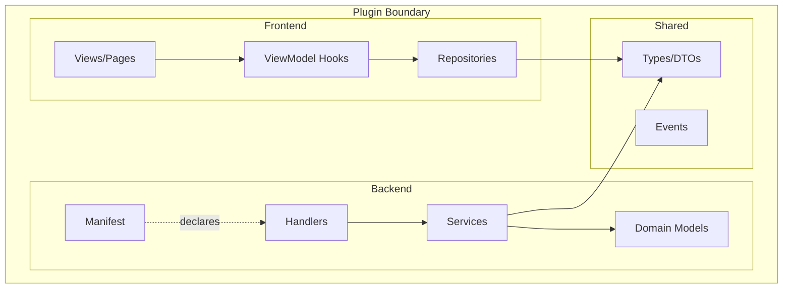
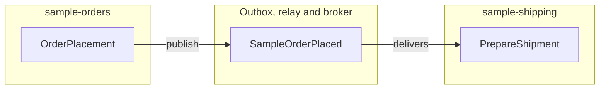

# Plugin Model

A **Plugin** is the smallest deployable and sellable business unit in Brix. It contains domain logic, UI components, and API endpoints, all depending only on Capability Contracts.

## Plugin Definition

:::info Key Concept
A plugin is self-contained. It can run in any host (Standalone or Embedded) without code changes.
:::



## Plugin Structure

```
my-plugin/
├── frontend/
│   ├── web/                    # Web UI (React)
│   │   ├── pages/              # Page components (View)
│   │   ├── components/         # Reusable UI components
│   │   ├── hooks/              # ViewModel hooks  
│   │   ├── repositories/       # API calls via HttpCapability
│   │   └── index.ts            # Plugin entry point
│   │
│   ├── mobile/                 # Mobile UI (React Native)
│   │   └── ...
│   │
│   └── shared/                 # Shared types
│       ├── types/              # TypeScript interfaces
│       └── events/             # Event type definitions
│
├── backend/
│   ├── api/                    # plugin-api: public DTOs, JSON schemas
│   │
│   ├── core/                   # plugin-core: domain logic (Layer 1)
│   │   ├── service/            # Domain services
│   │   ├── model/              # Domain entities
│   │   └── repository/         # Repository interfaces
│   │
│   ├── server/                 # plugin-server: entry point
│   │   ├── handler/            # Endpoint and event handlers
│   │   └── resources/META-INF/brix/plugin-manifest.yaml
│   │
│   └── test/                   # Tests including Architecture Guard
│
├── package.json                # Frontend dependencies
└── pom.xml                     # Backend dependencies
```

## Plugin Lifecycle

Plugins implement a standard lifecycle:

```typescript
// Frontend Plugin Module
export class MyPluginModule implements PluginModule {
  
  /**
   * Called when the plugin is loaded.
   * Register routes, capabilities, and event handlers.
   */
  async initialize(context: RuntimeContext): Promise<void> {
    // Register routes
    context.router.register('/my-plugin', MyPluginRoutes);
    
    // Subscribe to events
    const eventBus = context.getCapability(EventBusCapability);
    eventBus.subscribe('user.created', this.handleUserCreated);
  }
  
  /**
   * Called when the plugin is being unloaded.
   * Clean up resources, unsubscribe handlers.
   */
  async destroy(): Promise<void> {
    // Cleanup
  }
}
```

On the backend, the plugin class implements `io.runtime.sdk.plugin.BrixPlugin`. It sits in the plugin-server
artifact and is named in `META-INF/services/io.runtime.sdk.plugin.BrixPlugin`. There is no Spring configuration:

```java title="sample-orders-server: SampleOrdersPlugin.java"
public final class SampleOrdersPlugin implements BrixPlugin {

    /** The handler of {@code POST /api/sample-orders/orders}, as the manifest names it. */
    public static final String PLACE_ORDER = "sample-orders.place.v1";

    private final AtomicReference<BrixHealth> health = new AtomicReference<>(BrixHealth.down("not started"));

    @Override
    public void configure(PluginBootstrapContext bootstrap) {
        bootstrap.bindEndpointHandlerFactory(PLACE_ORDER, context -> new PlaceOrder(new OrderPlacement(
            context.require(PersistenceCapability.class),
            context.require(EventBusCapability.class),
            context.require(IdGeneratorCapability.class),
            Clock.systemUTC())));
    }

    @Override
    public void onStart(PluginContext context) {
        health.set(BrixHealth.up());
    }

    @Override
    public void onStop() {
        health.set(BrixHealth.down("stopped"));
    }

    @Override
    public BrixHealth health() {
        return health.get();
    }
}
```

The runtime drives the backend lifecycle. A plugin moves through these states:

| State | What happens |
|---|---|
| `DISCOVERED` | The runtime finds the plugin class and the manifest packaged with it |
| `RESOLVED` | The capabilities listed under `capabilities.required` are available |
| `WIRED` | `configure` has bound a handler factory to each handler ID the manifest declares, and the runtime has checked the bindings against the manifest |
| `STARTED` | The factories have created the handlers with the plugin's `PluginContext`, `onStart` has run, and the endpoints and subscriptions are open |
| `DRAINING`, `STOPPED` | The plugin stops accepting work, and `onStop` runs |
| `FAILED` | Startup failed, for example because a factory threw, or a binding names an ID the manifest does not declare |

`configure` only binds factories. Capabilities are reached in the factories, through `context.require(...)` and
`context.find(...)`. Here the factory creates the endpoint handler `PlaceOrder` around `OrderPlacement`, the domain
service in the plugin-core artifact. See [The plugin class](../guides/backend-development.md#the-plugin-class) for
the rules.

## Plugin Manifest

Each plugin declares its metadata and requirements in one YAML file,
`META-INF/brix/plugin-manifest.yaml`, packaged in its plugin-server artifact. There is no JSON manifest and no
`module-manifest.yaml`. The manifest is the only source of these facts: the code binds handlers to the IDs it
declares, and the runtime refuses a binding to an ID the manifest does not declare.

```yaml title="sample-orders-server: META-INF/brix/plugin-manifest.yaml (excerpt)"
apiVersion: brix.io/v1
kind: Plugin
metadata:
  pluginId: sample-orders
  name: sample-orders
  version: 3.2.0
  displayName: Sample Orders
  vendor: Brix Platform
  license: Apache-2.0
runtime:
  compiledAgainst: 3.2.0
  supportedRange: ">=3.2.0 <4.0.0"
# Three artifacts (root BRX-RS-MANIFEST-005): the contract, the logic and data, the entry point and handlers.
modules:
  - groupId: io.brix.samples
    artifactId: sample-orders-api
    version: 3.2.0
    moduleKind: plugin-api
  - groupId: io.brix.samples
    artifactId: sample-orders-core
    version: 3.2.0
    moduleKind: plugin-core
  - groupId: io.brix.samples
    artifactId: sample-orders-server
    version: 3.2.0
    moduleKind: plugin-server
capabilities:
  required:
    - id: io.runtime.sdk.capability.EventBusCapability
      version: ">=3.0.10 <4.0.0"
    - id: io.runtime.sdk.capability.PersistenceCapability
      version: ">=3.2.0 <4.0.0"
    - id: io.runtime.sdk.capability.IdGeneratorCapability
      version: ">=3.2.0 <4.0.0"
  optional: []
events:
  publishes:
    - eventType: SampleOrderPlaced
      schemaRef: brix://schemas/sample-orders/sample-order-placed/1.0.0
      version: 1.0.0
      reliability: STANDARD
    - eventType: SampleOrderActivity
      schemaRef: brix://schemas/sample-orders/sample-order-activity/1.0.0
      version: 1.0.0
      reliability: BEST_EFFORT
  subscribes: []
data:
  storageId: sample_orders
  schema: sample-orders
  migrationLocation: db/migration/sample-orders
  outbox: sample_orders_outbox
permissions:
  - id: sample-orders:order:place
    name: Place sample orders
    description: Allows placing an order in the current tenant.
    grants:
      - {role: OWNER, scope: TENANT}
      - {role: ADMIN, scope: TENANT}
      - {role: MEMBER, scope: TENANT}
```

`modules` lists the plugin's three artifacts with their roles. Only the server artifact carries the manifest; the
classes of the api and core artifacts belong to the plugin because the manifest lists them.

The full manifest also declares the plugin's HTTP endpoints (`endpoints.provides`), queries, commands and tasks.
[The manifest](../guides/backend-development.md#the-manifest) in the Backend Development Guide describes every
section.

## Plugin Dependencies

:::warning Design Constraint #4
> Plugins talk to each other through queries, commands and events, never by calling each other.
:::

Each need has one channel:

| Need | Channel | Semantics |
|---|---|---|
| Read data another plugin owns | Typed query | Synchronous, read-only, may fail |
| Ask another plugin to change its data | Typed command | Asynchronous, one owner that accepts or refuses it, delivered reliably |
| Tell others about a fact you have committed | Integration event | Asynchronous, zero or more subscribers, directs no one |

Plugins must NOT:
- Depend on another plugin's core or server artifact
- Call another plugin's endpoints, services or repositories
- Read or write another plugin's tables

Name an event as a fact in the past tense, such as `SampleOrderPlaced`. A request for another plugin to act is a
command, not an event. A process of several steps sends commands and watches events; there are no distributed
transactions. [Events and Commands](../guides/events-and-commands.md) shows both, and [Queries](../guides/queries.md)
shows how a plugin publishes a typed query and how another one calls it.



## Frontend Plugin Architecture

The frontend follows the **View → ViewModel → Repository** pattern:

### View Layer (Pages/Components)
- Pure rendering, no business logic
- Uses hooks for data and actions
- No direct HTTP/fetch calls

```tsx
// ✅ Correct - Uses hook
function ReservationList() {
  const { reservations, loading } = useReservations();
  return <List data={reservations} loading={loading} />;
}

// ❌ Wrong - Direct fetch
function ReservationList() {
  const [data, setData] = useState([]);
  useEffect(() => {
    fetch('/api/reservations').then(...); // VIOLATION!
  }, []);
}
```

### ViewModel Layer (Hooks)
- Business logic and state management
- Orchestrates repository calls
- Handles UI state (loading, errors)

```typescript
function useReservations() {
  const http = useCapability(HttpCapability);
  const repo = new ReservationRepository(http);
  
  // State and business logic here
  return { reservations, loading, create, cancel };
}
```

### Repository Layer
- API calls via HttpCapability
- Data transformation
- Caching logic

```typescript
class ReservationRepository {
  constructor(private http: HttpCapability) {}
  
  async getAll(): Promise<Reservation[]> {
    return this.http.get('/api/reservations');
  }
}
```

## Backend Plugin Architecture

A backend plugin is three Maven artifacts, one per layer. The manifest names each under `modules` with its
`moduleKind`.

### API Layer (`plugin-api`)
- The records other code reads: request, response and event payloads
- The JSON schemas of those contracts
- No logic and no framework

### Core Layer (`plugin-core`)
- Domain services and entities
- Business rules
- Uses only Capability interfaces and the plugin's own repositories
- Depends on the API layer

### Server Layer (`plugin-server`)
- The plugin class, which binds a handler factory to each handler ID the manifest declares
- Endpoint and event handlers: they read the request, call the domain services and map the result
- The manifest; the runtime publishes the HTTP routes and subscriptions it declares (no REST controllers)
- The migrations of the plugin's business tables
- Depends on the Core layer

`sample-orders` is built this way:

```text
sample-orders-api/                        plugin-api
├── SampleOrderEvents.java                event type names
├── SampleOrderPlacedPayload.java         event payloads
├── SampleOrderActivityPayload.java
├── PlaceOrderRequest.java                endpoint request and response
├── PlacedOrder.java
└── META-INF/brix/schemas/sample-orders/  JSON schemas
sample-orders-core/                       plugin-core
├── OrderPlacement.java                   domain service: rules, unit of work, events
├── InvalidOrderException.java
├── SampleOrder.java                      entity
├── SampleOrderRepository.java
├── SampleOrderPlaced.java                integration events
└── SampleOrderActivity.java
sample-orders-server/                     plugin-server
├── SampleOrdersPlugin.java               binds the handler factory
├── PlaceOrder.java                       endpoint handler
└── resources/
    ├── META-INF/brix/plugin-manifest.yaml
    ├── META-INF/services/io.runtime.sdk.plugin.BrixPlugin
    └── db/migration/sample-orders/V1__sample_orders.sql
```

`OrderPlacement` holds the order's rules, stores the order and publishes the events. `PlaceOrder` only maps HTTP to
it and back.

The [Backend Development Guide](../guides/backend-development.md) shows each piece with code from the sample
plugins.

## Plugin Isolation

Plugins run in one JVM and share the host's database. The runtime keeps them apart by ownership, checked at startup
and on every call:

| Aspect | How plugins are kept apart |
|--------|-----------------|
| Code | A plugin must not depend on another plugin's core or server artifact. `sample-shipping` depends on no `sample-orders` artifact at all: the two share only an event schema. |
| Data | Each table has one owning plugin. The persistence adapter refuses an entity that maps another plugin's table, and a repository interface that belongs to another plugin. Each plugin's migrations keep their own history, and its messaging tables are named after its `storageId`. |
| Tenants | Every business row has a `tenant_id`, and the adapter keeps every read and write inside the unit of work's tenant. |
| Capabilities | A plugin reaches only the capabilities its manifest lists, through its own `PluginContext`. Its `PersistenceCapability` reaches only its own data. |
| Events | An event type has exactly one publisher: the plugin that declares it under `events.publishes`. If two plugins declare the same type, neither starts. Event types need no plugin prefix: `sample-orders` publishes `SampleOrderPlaced`. The runtime binds the publisher and the tenant itself, so an event cannot claim another publisher. |
| HTTP and permissions | The runtime checks the caller, the tenant and the permissions an endpoint declares before the handler runs. A method and path, and a permission ID, each belong to one plugin. |
| State store | Keys are not separated per plugin or tenant. Put your plugin id and the tenant in each key, as the [Hello Plugin](../examples/hello-plugin.md) does. |

A subscriber names the plugin it trusts as the publisher, as `publisherPolicyRef: <pluginId>-owner`
(`sample-shipping` names `sample-orders-owner`). If another plugin publishes that event type, the subscriber does not
start.

## Next Steps

- [Event Model](./event-model) - Inter-plugin communication
- [Plugin Development Guide](../guides/plugin-development) - Build a complete plugin
- [Testing Guide](../guides/testing) - Test your plugins
