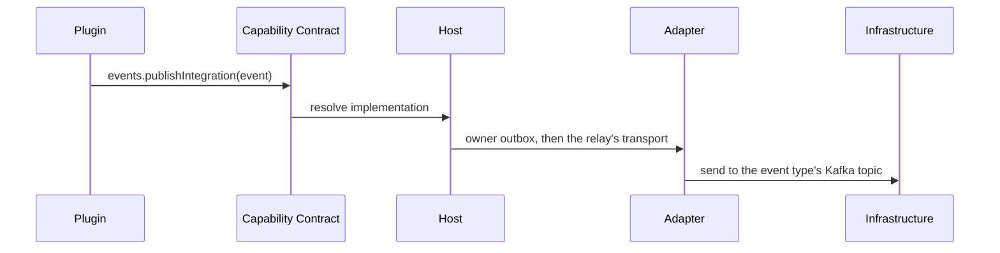

# Quick Start

Create your first Brix plugin in under 5 minutes.

## Prerequisites

Make sure you have completed the [Installation](./installation) guide.

## Step 1: Create a New Plugin

```bash
# Create a new plugin called "todo"
create-brix phase7 plugin todo --runtime-version 3.2.0 --runtime-range ">=3.2.0 <4.0.0"
```

`create-brix` is the CLI of `@brix-sdk/create-brix` (see [Installation](./installation)). Its `plugin` command is
legacy and disabled: `phase7 plugin` is the one that works. Pass the runtime version and range explicitly, so the
plugin targets the runtime you run.

This generates the plugin's three backend modules and its entry point:

```
app-todo/
├── pom.xml               # Parent of the three modules
├── app-todo-api/         # plugin-api: records and JSON schemas
├── app-todo-core/        # plugin-core: domain logic, entities, repositories
├── app-todo-server/      # plugin-server: plugin class, manifest, services file
├── migration/            # Phase 7 migration plan
└── README.md
```

`create-brix phase7 ui todo` generates a web module, `todo-ui-web`, the same way.

## Step 2: Understand the Structure

### Frontend (Layer 1 - Plugin)

```typescript title="todo-ui-web: src/hooks/useTodoList.ts"
import { useCapability } from '@brix/runtime-sdk-api-web';
import { HttpCapability } from '@brix/runtime-sdk-api-web';

/**
 * ViewModel hook for TODO list management.
 * 
 * Note: No direct HTTP calls! Uses HttpCapability from runtime.
 */
export function useTodoList() {
  // Get HTTP capability from runtime - NOT axios/fetch
  const http = useCapability(HttpCapability);
  
  const fetchTodos = async () => {
    return http.get('/api/todos');
  };
  
  return { fetchTodos };
}
```

### Backend (Layer 1 - Plugin)

```java title="app-todo-server: CompleteTodo.java"
import io.runtime.sdk.capability.EventBusCapability;
import io.runtime.sdk.capability.PersistenceCapability;
import io.runtime.sdk.plugin.EndpointHandler;
import io.runtime.sdk.plugin.EndpointInvocation;

/**
 * POST /api/todos/{todoId}/complete: no Kafka, no database driver. The plugin's configure(...) binds it with
 * bootstrap.bindEndpointHandlerFactory("todo.complete.v1", context -> new CompleteTodo(
 *     context.require(PersistenceCapability.class), context.require(EventBusCapability.class)));
 */
final class CompleteTodo implements EndpointHandler<EndpointInvocation<Object>, Object> {

    private final PersistenceCapability persistence;
    private final EventBusCapability events;

    CompleteTodo(PersistenceCapability persistence, EventBusCapability events) {
        this.persistence = persistence;
        this.events = events;
    }

    @Override
    public Object handle(EndpointInvocation<Object> request) {
        String todoId = request.pathVariables().get("todoId");
        return persistence.unitOfWork().required(() -> {
            // Business logic here, then publish the event the manifest declares under events.publishes;
            // it commits together with the change.
            events.publishIntegration(new TodoCompleted(todoId, request.tenantId().orElseThrow()));
            return java.util.Map.of("todoId", todoId, "status", "COMPLETED");
        });
    }
}
```

## Step 3: Run the Plugin

A plugin does not run on its own: a host runs it. The host is a Spring Boot application with no business code, and
the plugin's server artifact is on its class path. [Run and Test](./create-first-plugin.md#part-6-run-and-test) in
the tutorial sets up a host the way the repository's `sample-e2e` does.

## Step 4: Run Architecture Tests

The scaffold generates no tests. Add the Architecture Guard test from
[Architecture Tests](./create-first-plugin.md#part-5-architecture-tests) to each backend module that has code, then
run:

```bash
mvn test
```

These tests enforce the Brix design constraints automatically. A class that breaks a rule fails the build.

## What's Happening Under the Hood?

1. **Your plugin code** uses only Capability Contracts (interfaces)
2. **At runtime**, the Host injects actual implementations (Kafka, Redis, etc.)
3. **During testing**, you can inject mocks without any infrastructure



## Next Steps

- [Create First Plugin](./create-first-plugin) - Detailed step-by-step tutorial
- [Plugin Model](../concepts/plugin-model) - Understand plugin structure
- [Capability Contract](../concepts/capability-contract) - Available capabilities
- [Architecture Guard](../guides/architecture-guard) - Red-line rules explained
