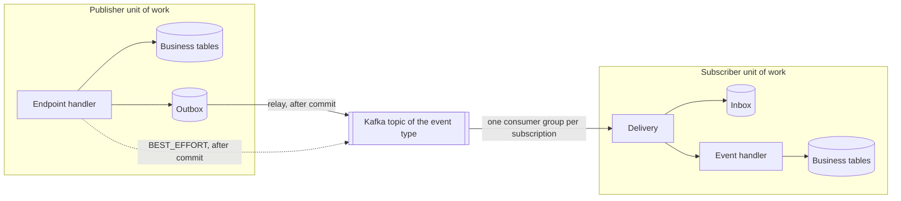

# Events and Commands

This chapter is for plugin authors. It shows how a plugin publishes integration events, handles them, and sends
commands to another plugin on the platform's standard chain. You declare what you publish, subscribe to and
provide in your plugin manifest, and you write the handlers. The runtime does the rest:
- transactions, outbox and relay;
- the broker and topics;
- retries and parking;
- inbox deduplication;
- tenant binding;
- retention.

Your plugin never sees Kafka, a topic name or a consumer group.

Two sample plugins in the repository show every step. They run end to end on PostgreSQL and Kafka in the build.
Each is three artifacts:
- `-api` holds the records other code reads, such as event payloads, and their JSON schemas;
- `-core` holds the domain service, the entities and the event classes;
- `-server` holds the plugin class, the handlers, the manifest and the migration.

| Sample | Path | What it shows |
|---|---|---|
| `sample-orders` | `packages/@brix/samples/sample-orders-api`, `-core`, `-server` | An HTTP endpoint places an order; the domain service writes it and publishes a STANDARD event through the outbox and a BEST_EFFORT event |
| `sample-shipping` | `packages/@brix/samples/sample-shipping-api`, `-core`, `-server` | A subscriber with a persistent inbox that prepares one shipment per order, and an endpoint that shows it |
| `sample-e2e` | `packages/@brix/samples/sample-e2e` | Both plugins in a host made of configuration only |

## How a message travels



1. The publisher writes its business change and the event in one local transaction. The event lands in the
   publisher's outbox, so the two commit or roll back together.
2. After the commit, the relay sends the event to the broker. If the broker cannot be reached, the relay waits and
   the event stays in the outbox. Waiting does not count as a failed attempt.
3. Each subscription has its own consumer. The runtime opens the subscriber's unit of work in the event's tenant,
   records `(handlerId, eventId)` in the subscriber's inbox, and calls the handler. The receipt and the handler's
   writes commit together.
4. A redelivered event finds its receipt and never reaches the handler again.

## What the platform guarantees

| Topic | Guarantee |
|---|---|
| Delivery | CRITICAL and STANDARD events are delivered **at least once** after the publisher commits, and never if it rolls back. With a persistent inbox, each handler applies an event **once**. |
| Order | A subscriber sees the events of **one event type with the same partition key** (the event's routing key) in publish order. There is no order across event types or keys. To order events of different types for one aggregate, put the aggregate's version in the payloads and compare it in the subscriber. |
| New subscriptions | A subscription starts at the moment it is first registered. It does not receive older events; a renamed `handlerId` is a new subscription. For history, an operator republishes events that are still in the outbox (see [Operating](#operating)). |
| Failures | A handler that throws is retried with exponential backoff and jitter. After the last attempt the event is **parked** for an operator, and later events of the subscription go on. A handler that runs past its deadline is cancelled and counts as a failed attempt. |
| Outages | If the subscriber's database is down or the plugin is not started, the subscription pauses. Attempts are not used up, and the event is delivered once the cause is gone. |
| Tenancy | A TENANT event is handled in its own tenant; a PLATFORM event in none. The runtime binds the producer and the tenant from the publishing unit of work. An event cannot claim another publisher or tenant. |
| Contracts | Each event type has one publisher. Its payload has a versioned JSON schema, and subscribers name the schema range they accept. |

## Publishing an event

### 1. Declare it

```yaml title="sample-orders-server: META-INF/brix/plugin-manifest.yaml (excerpt)"
capabilities:
  required:
    - id: io.runtime.sdk.capability.EventBusCapability
      version: ">=3.0.10 <4.0.0"
    - id: io.runtime.sdk.capability.PersistenceCapability
      version: ">=3.2.0 <4.0.0"
    - id: io.runtime.sdk.capability.IdGeneratorCapability
      version: ">=3.2.0 <4.0.0"
  optional: []
events:
  publishes:
    # Through the outbox, in the order's unit of work: delivered at least once after the order commits.
    - eventType: SampleOrderPlaced
      schemaRef: brix://schemas/sample-orders/sample-order-placed/1.0.0
      version: 1.0.0
      reliability: STANDARD
    # Sent after the commit, not retried: for nothing that must happen.
    - eventType: SampleOrderActivity
      schemaRef: brix://schemas/sample-orders/sample-order-activity/1.0.0
      version: 1.0.0
      reliability: BEST_EFFORT
  subscribes: []
# The platform creates sample_orders_outbox from its own versioned migrations; db/migration/sample-orders holds only
# the plugin's business tables.
data:
  storageId: sample_orders
  schema: sample-orders
  migrationLocation: db/migration/sample-orders
  outbox: sample_orders_outbox
```

- The event type needs no plugin prefix, but only one plugin in a host may declare it under `events.publishes`. If
  two do, neither starts.
- `data.outbox` is always `<storageId>_outbox`.

Choose the reliability per event type:

| Reliability | Path | Use it for |
|---|---|---|
| `CRITICAL` | Outbox, in your unit of work | Facts other plugins must act on and that you would page someone about if they stalled |
| `STANDARD` | Outbox, in your unit of work | Most business facts |
| `BEST_EFFORT` | Sent after your unit of work commits; no outbox, no retry | Signals nothing depends on, such as activity feeds and refresh hints |

CRITICAL and STANDARD travel the same path. The difference is how you alert on them. A plugin that publishes only
BEST_EFFORT events needs no outbox.

### 2. Write the schema

Put the schema at `META-INF/brix/schemas/<pluginId>/<name>/<version>.json`, in your api artifact. Its `$id` must
equal the `schemaRef`. It must allow no other fields, and it must name exactly the fields of the payload record:

```json title="sample-orders-api: META-INF/brix/schemas/sample-orders/sample-order-placed/1.0.0.json"
{
  "$schema": "https://json-schema.org/draft/2020-12/schema",
  "$id": "brix://schemas/sample-orders/sample-order-placed/1.0.0",
  "title": "An order was placed",
  "description": "Payload of SampleOrderPlaced. sample-orders publishes it STANDARD, TENANT-scoped, through its outbox in the unit of work that places the order. version is the order's version, for subscribers that order events of several types (Kafka design D31). x-brix-classification marks each field (root BRX-RS-SECURITY-008).",
  "type": "object",
  "additionalProperties": false,
  "required": ["tenantId", "orderId", "sku", "quantity", "version"],
  "properties": {
    "tenantId": { "type": "integer", "x-brix-classification": "internal-identifier" },
    "orderId": { "type": "string", "maxLength": 32, "x-brix-classification": "internal-identifier" },
    "sku": { "type": "string", "maxLength": 64, "x-brix-classification": "operational" },
    "quantity": { "type": "integer", "minimum": 1, "maximum": 1000, "x-brix-classification": "operational" },
    "version": { "type": "integer", "minimum": 1, "x-brix-classification": "operational" }
  }
}
```

`x-brix-classification` gives each field its data class. Classify the fields of your own schemas the same way.

The payload record sits next to the schema, in `sample-orders-api`:

```java title="sample-orders-api: SampleOrderPlacedPayload.java"
public record SampleOrderPlacedPayload(long tenantId, String orderId, String sku, int quantity, long version) {
}
```

The runtime refuses to start a plugin whose declared schema file is missing or has another `$id`. Check that the
payload matches the schema in your own build with `EventSchemaContract` from the `runtime-orchestrator` test jar:

```java title="sample-orders-server: SampleOrdersEventSchemasTest.java (excerpt)"
EventSchemaContract.verify(SampleOrdersPlugin.class, Map.of(
    SampleOrderEvents.PLACED, new SampleOrderPlacedPayload(42L, "1001", "sku-1", 2, 1L),
    SampleOrderEvents.ACTIVITY, new SampleOrderActivityPayload(42L, "1001", "placed")));
```

To change a contract compatibly, add an optional field in a new minor version. A breaking change is a new major
version, and subscribers opt in by widening their `schemaRange`.

### 3. Write the event class

The event class lives in your core artifact, next to the domain service that publishes it. The event type names
are constants in the api artifact:

```java title="sample-orders-api: SampleOrderEvents.java (excerpt)"
/** The publishing plugin. */
public static final String PUBLISHER = "sample-orders";

/** An order was placed: STANDARD, through the outbox; payload {@link SampleOrderPlacedPayload}. */
public static final String PLACED = "SampleOrderPlaced";
```

```java title="sample-orders-core: SampleOrderPlaced.java"
public final class SampleOrderPlaced extends IntegrationEvent {

    private static final long serialVersionUID = 1L;

    private final SampleOrderPlacedPayload payload;

    SampleOrderPlaced(SampleOrder order) {
        // The tenant makes it a TENANT event; the runtime binds the publisher itself.
        super(SampleOrderEvents.PUBLISHER, String.valueOf(order.tenantId()));
        this.payload = new SampleOrderPlacedPayload(order.tenantId(), String.valueOf(order.getId()), order.sku(),
            order.quantity(), order.version());
    }

    @Override
    public String eventTypeId() {
        return SampleOrderEvents.PLACED;
    }

    @Override
    public String getRoutingKey() {
        return "order." + payload.orderId();
    }

    @Override
    public Object payload() {
        return payload;
    }
}
```

- `eventTypeId()` returns the `eventType` the manifest declares under `events.publishes`.
- `getRoutingKey()` is the partition key: a subscriber sees the `SampleOrderPlaced` events of one order in publish
  order.
- `payload()` is what subscribers receive: the api record that the schema describes.
- The constructor is package-private, so only the core creates the event.

### 4. Publish inside your unit of work

Get the bus and the persistence capability in a handler factory, and hand them to the domain service:

```java title="sample-orders-server: SampleOrdersPlugin.java (excerpt)"
bootstrap.bindEndpointHandlerFactory(PLACE_ORDER, context -> new PlaceOrder(new OrderPlacement(
    context.require(PersistenceCapability.class),
    context.require(EventBusCapability.class),
    context.require(IdGeneratorCapability.class),
    Clock.systemUTC())));
```

The domain service publishes where the business change happens, in the same unit of work:

```java title="sample-orders-core: OrderPlacement.java (excerpt)"
return persistence.unitOfWork().required(() -> {
    SampleOrder placed = SampleOrder.place(Long.parseLong(ids.generate()), tenantId, request.sku(),
        request.quantity(), OffsetDateTime.now(clock));
    persistence.repository(SampleOrderRepository.class).save(placed);
    events.publishIntegration(new SampleOrderPlaced(placed));
    events.publishIntegration(new SampleOrderActivity(placed, "placed"));
    return placed;
});
```

`SampleOrderPlaced` is STANDARD: it goes into the outbox in this transaction, and exists if and only if the order
does. `SampleOrderActivity` is BEST_EFFORT: it is sent once the transaction has committed.

The runtime refuses a publish, with an exception, in these cases:
- the event type is not declared under `events.publishes`;
- a CRITICAL or STANDARD event is published outside your unit of work, or in a read-only one (a GET endpoint runs
  read-only);
- a TENANT event names a tenant your unit of work does not reach;
- the event has no `payload()`.

## Handling an event

### 1. Declare the subscription

```yaml title="sample-shipping-server: META-INF/brix/plugin-manifest.yaml (excerpt)"
capabilities:
  required:
    - id: io.runtime.sdk.capability.PersistenceCapability
      version: ">=3.2.0 <4.0.0"
    - id: io.runtime.sdk.capability.IdGeneratorCapability
      version: ">=3.2.0 <4.0.0"
  optional: []
events:
  publishes: []
  subscribes:
    - subscriptionId: prepare-shipment
      eventType: SampleOrderPlaced
      # Any 1.x of the publisher's schema; a 2.0.0 event is parked instead of misread.
      schemaRange: ">=1.0.0 <2.0.0"
      handlerId: sample-shipping.prepare-shipment.v1
      # A TENANT event is handled in its own tenant.
      scopePolicyRef: sample-shipping-order-tenant
      # Only the plugin that declares SampleOrderPlaced may publish it.
      publisherPolicyRef: sample-orders-owner
      timeoutPolicyRef: event-standard
      concurrencyPolicyRef: partition-serial
      retryPolicyRef: event-standard
      idempotencyPolicyRef: persistent-inbox
# The platform creates sample_shipping_inbox from its own versioned migrations; db/migration/sample-shipping holds
# only the plugin's business tables.
data:
  storageId: sample_shipping
  schema: sample-shipping
  migrationLocation: db/migration/sample-shipping
  inbox: sample_shipping_inbox
```

- `publisherPolicyRef` is `<publisher pluginId>-owner`. If another plugin publishes the event type, the subscriber
  does not start.
- `data.inbox` is always `<storageId>_inbox`.
- `handlerId` identifies the subscription for good: its consumer group, its inbox rows and its parked events. Keep
  it stable. Change it, for example by adding `.v2`, only when you want a new subscription that starts from now.
- The platform's policy catalog has `event-standard` for retry and timeout and `partition-serial` for concurrency.
  The runtime refuses an unknown policy at startup.
- Use `persistent-inbox` unless the event is BEST_EFFORT and your handler is harmless to repeat. In that case,
  `no-durable-idempotency` needs no inbox.

### 2. Write the handler

The handler class names its payload type, and the runtime decodes each event into it. Keep your own record of the
fields you read rather than depending on the publisher's classes: the two plugins share only the schema.
`sample-shipping` keeps that record in its core and depends on no `sample-orders` artifact:

```java title="sample-shipping-core: OrderPlaced.java"
public record OrderPlaced(long tenantId, String orderId, String sku, int quantity, long version) {
}
```

The handler, in the server artifact, hands the event to the core's domain service:

```java title="sample-shipping-server: PrepareShipment.java"
final class PrepareShipment implements EventHandler<OrderPlaced> {

    private final ShipmentDesk shipments;

    PrepareShipment(ShipmentDesk shipments) {
        this.shipments = Objects.requireNonNull(shipments, "shipments must not be null");
    }

    @Override
    public CompletionStage<Void> handle(EventInvocation<OrderPlaced> invocation) {
        shipments.prepare(invocation.event().payload());
        return CompletableFuture.completedFuture(null);
    }
}
```

```java title="sample-shipping-core: ShipmentDesk.java (excerpt)"
public SampleShipment prepare(OrderPlaced order) {
    Objects.requireNonNull(order, "order must not be null");
    return persistence.unitOfWork().required(() -> persistence.repository(SampleShipmentRepository.class)
        .save(SampleShipment.prepare(Long.parseLong(ids.generate()), order, OffsetDateTime.now(clock))));
}
```

The plugin class binds the handler's factory under the subscription's `handlerId`:

```java title="sample-shipping-server: SampleShippingPlugin.java (excerpt)"
bootstrap.bindEventHandlerFactory(PREPARE_SHIPMENT, context -> new PrepareShipment(desk(context)));
// ...
private static ShipmentDesk desk(PluginContext context) {
    return new ShipmentDesk(context.require(PersistenceCapability.class),
        context.require(IdGeneratorCapability.class), Clock.systemUTC());
}
```

- The runtime calls the handler inside your unit of work, already in the event's tenant. `required(...)` in
  `ShipmentDesk` joins it, so the shipment and the inbox receipt commit together. Do the work synchronously and
  return a completed stage.
- To fail, throw. Your writes and the inbox receipt roll back, and the event is retried.
- `invocation.event()` also carries the event id, type, schema version, tenant, partition key and trace.
- `invocation.deliveryAttempt()` tells you how many attempts there have been.

## Commands

Use a command when you need another plugin to change **its** data. Do not use an event that you expect someone to
act on. A command has exactly one provider, travels the same outbox, broker and inbox chain, and is deduplicated
twice:
- by its command id, in the provider's inbox;
- by your business idempotency key, in the provider's idempotency table.

The consumer declares the command and submits it:

```yaml
capabilities:
  required:
    - id: io.runtime.sdk.capability.CommandCapability
      version: ">=3.2.0 <4.0.0"
commands:
  consumes:
    - commandType: ReserveStock
      versionRange: ">=1.0.0 <2.0.0"
      required: true
      timeoutPolicyRef: event-standard
      retryPolicyRef: event-standard
      idempotencyPolicyRef: persistent-inbox
data:
  storageId: shop
  outbox: shop_outbox                       # commands leave through your outbox
```

```java
CommandSubmission submission = commands.submit(
    CommandRequest.of("ReserveStock", new ReserveStock(sku, quantity), "order", orderId));
// durableReceipt() completes once your unit of work has committed and the command is queued (status QUEUED).
// It does not mean the provider accepted it: the provider reports the outcome with its own events.
```

The provider declares and binds a `CommandHandler`:

```yaml
commands:
  provides:
    - commandType: ReserveStock
      request:
        schemaRef: brix://schemas/inventory/reserve-stock/1.0.0
      handlerId: inventory.reserve-stock.v1
      scopePolicyRef: platform
      accessPolicyRef: platform
      timeoutPolicyRef: event-standard
      concurrencyPolicyRef: partition-serial
      retryPolicyRef: event-standard
      idempotencyPolicyRef: persistent-inbox
```

```java
bootstrap.bindCommandHandlerFactory("inventory.reserve-stock.v1", context -> new ReserveStockHandler(...));

final class ReserveStockHandler implements CommandHandler<ReserveStock> {
    @Override
    public CompletionStage<Void> handle(CommandInvocation<ReserveStock> invocation) {
        ReserveStock request = invocation.command().payload();
        // change your data, then publish the outcome as an event
        return CompletableFuture.completedFuture(null);
    }
}
```

The runtime does not run the handler twice:
- for a second command with the same `(handlerId, idempotency scope, idempotency key)`;
- for a redelivered command id.

## Tables: what the platform creates for you

Do not write messaging DDL. When your manifest declares one of the following, the platform creates the table from
its own versioned migrations, after your migrations and in its own schema history:

| You declare | The platform creates |
|---|---|
| `data.outbox` | `<storageId>_outbox` |
| `data.inbox` | `<storageId>_inbox` |
| `commands.provides` | `<storageId>_command_idempotency` |

Your `data.migrationLocation` holds only your business tables. At startup the runtime checks every messaging table's
columns, keys and indexes, and refuses a plugin whose tables differ. The platform migrations are for PostgreSQL, the
reference database.

Business tables follow the persistence rules:
- every row names its `tenant_id`;
- ids come from `IdGeneratorCapability`, never from the database.

`SampleOrder` in `sample-orders-core` and `SampleShipment` in `sample-shipping-core` show how an entity with assigned
ids tells Spring Data that it is new.

## Testing

| Level | How |
|---|---|
| Contract | `EventSchemaContract.verify(...)` in the publisher's build, as above |
| Domain service and handler | Plain unit tests: both are classes with constructor arguments. See [Unit tests](./backend-development.md#unit-tests). |
| End to end | Start your plugins in a host made of configuration, as `sample-e2e` does: a throwaway PostgreSQL schema, an embedded Kafka broker, real HTTP, then wait for the outbox row, the subscriber's change and the inbox receipt |
| Transport | Adapter authors run the transport conformance suite (`EventTransportConformance` in the `runtime-orchestrator` test jar); every transport passes it |

## Operating

**Metrics** (Prometheus names):

| Area | Metrics |
|---|---|
| Outbox | `brix_outbox_messages{outbox,status}`, `brix_outbox_oldest_pending_age_seconds`, `brix_outbox_relay_waiting` |
| Subscriptions | `brix_event_subscription_parked`, `_lag`, `_stalled_age_seconds`, `_handling_age_seconds`, `_consumer_running` |
| Cleaning | `brix_messaging_retention_deleted_total`, `_failures_total`, `_last_pass_seconds` |

Subscription readiness is part of the host's health.

**Parked messages.** The management port lists parked messages. Every action needs an `operator` and a `reason`. It is
recorded in the platform audit before it takes effect, and it is refused if the audit cannot be written:

| Request | Effect |
|---|---|
| `GET /actuator/outbox` and `GET /actuator/events` | List parked messages, without payloads |
| `POST /actuator/outbox/{eventId}` | Send a parked outbox message again |
| `DELETE /actuator/outbox/{eventId}?operator=…&reason=…` | Discard a parked outbox message |
| `POST /actuator/outbox/{eventId}/republish` | Send a published message again while the outbox keeps it |
| `POST /actuator/events/{subscription}/{eventId}` | Deliver one parked event to its subscription again |
| `POST /actuator/events/{subscription}` | Replay the subscription's parked events, earliest first, stopping at the first failure |
| `DELETE /actuator/events/{subscription}/{eventId}?operator=…&reason=…` | Discard a parked event |

POST bodies are `{"operator": "...", "reason": "..."}`. Event ids never change, so subscribers that already applied
an event skip it through their inbox.

**Retention** (`brix.outbox.relay.retention.*`):
- Published and discarded outbox rows are kept 14 days. A message can be republished during that time.
- Inbox and command idempotency records are kept 30 days.
- Kafka topics keep 7 days.

The host refuses to start if the inbox retention is shorter than the outbox retention plus the broker's. Parked
messages stay until an operator acts.

**Kafka in production.** Under the `prod` or `production` profile, the host refuses to start unless:
- the clients use TLS with a client certificate, set under `brix.infra.kafka.client.*` (`security.protocol: SSL`,
  `ssl.keystore.*`, `ssl.truststore.*`);
- topics have at least 3 replicas;
- `min.insync.replicas` is at least 2.

## Do and don't

- Do declare everything in the manifest. Don't use `@KafkaListener`, `KafkaTemplate`, topic names or the legacy
  `@EventHandler` annotation in plugin code.
- Do publish in the unit of work that changes your data. Don't publish from a GET endpoint or after the transaction.
- Do keep handlers deterministic and side-effect free outside your own data. A retried handler runs again until its
  transaction commits.
- Do own your payload records and schemas. Don't depend on another plugin's classes.
- Don't use an event as a command. If you need someone to change their data, send them a command.
