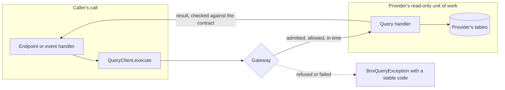

# Queries

This chapter is for plugin authors. A typed query lets a plugin read data another plugin owns while it handles a
request, without touching that plugin's tables or code. The provider publishes a versioned contract and a handler.
The caller declares the query in its manifest and calls a client generated from the contract. The runtime does the
rest:
- it resolves each caller to exactly one provider at startup;
- it passes on the caller plugin, the user, the tenant, the trace and the deadline of the call being handled;
- it applies the provider's access policy;
- it runs the provider in its own read-only unit of work;
- it protects the provider with a deadline, a circuit breaker and a concurrency limit;
- it reports failures with stable codes, spans and metrics.

Your plugin never sees another plugin's repository, a URL or a query name as a string.

| You need | Use |
|---|---|
| To read another plugin's current data while you handle a request | A query |
| To tell others that something happened | An [event](./events-and-commands.md) |
| Another plugin to change its data | A [command](./events-and-commands.md#commands) |

A query never changes anything. Its provider cannot write, publish an event, submit a command or send a notification.

The repository has these examples:

| Example | Path | What it shows |
|---|---|---|
| `sample-shipping` | `packages/@brix/samples/sample-shipping-api`, `-server` | Provides `sample-shipping.find-shipment`, the shipment of an order, for users who may read shipments |
| `sample-orders` | `packages/@brix/samples/sample-orders-server` | The order detail endpoint calls it as an optional query and says when shipments are unavailable |
| `sample-e2e` | `packages/@brix/samples/sample-e2e` | Runs both on PostgreSQL, then sample-orders alone, without a provider |
| `platform-tenant` | `packages/@brix/platform-commons/packages/server/platform-tenant-api`, `platform-tenant` | Provides `TenantReferenceQuery`, which every plugin uses to check the member and principal ids it stores |

## How a query travels



1. The caller's handler calls `execute` on its client. The call runs on the caller's thread and blocks until the
   result comes back or the deadline passes.
2. The gateway checks five things before the provider runs:
   - the call is one the runtime admitted, such as an endpoint, event or command handler;
   - the provider is published and ready;
   - the caller's user may read the data;
   - there is time left;
   - the provider's breaker and concurrency limit let the call through.
3. The runtime suspends the caller's transaction and opens the provider's read-only unit of work in the caller's
   tenant. The provider's handler reads its own tables.
4. The result is checked against the declared contract type and returned. Not finding anything is an empty result,
   not a failure.

## What the platform guarantees

| Topic | Guarantee |
|---|---|
| Contract | Each query type and major version has one provider. The caller and the provider use the same generated types. A manifest, handler or type that does not match the contract keeps the plugin from starting. |
| Identity | The caller plugin, the user, the tenant, the access decision, the trace and the deadline come from the call being handled. A request cannot carry or replace them. |
| Tenancy | With `query-caller-tenant` the provider runs in the caller's tenant. Data of another tenant is not found, just like data that does not exist. |
| Read only | The provider runs in its own read-only unit of work, and the caller's transaction is suspended meanwhile. Writes, events, commands and notifications from a query handler are refused. |
| Deadline | A query gets the earliest of four limits: the time left in the caller's call, the caller's timeout policy, the provider's timeout policy and the host's hard cap. A query that runs out of time fails with `query.deadline_exceeded`; it never returns a partial or empty result. |
| Protection | Each caller and query pair has its own circuit breaker, so a caller sending bad requests does not cut off the others. Each query has a concurrency limit. |
| Readiness | A plugin that requires a query is ready only once a ready provider publishes it. An optional query never holds a plugin back, and an open breaker does not make a plugin unready. |
| Failures | Every failure is a `BrixQueryException` with a stable code (see [Errors](#errors)). The cause stays in the logs. |

## Publishing a query

### 1. Write the contract

The contract lives in your `-api` artifact, the only artifact another plugin may depend on. It has three parts.

The query file is `META-INF/brix/queries/<queryType>/<version>.json`. It names the query, its two schemas and whether
it may find nothing:

```json title="sample-shipping-api/src/main/resources/META-INF/brix/queries/sample-shipping.find-shipment/1.0.0.json"
{
  "queryType": "sample-shipping.find-shipment",
  "version": "1.0.0",
  "request": "brix://schemas/sample-shipping/find-shipment-request/1.0.0",
  "response": "brix://schemas/sample-shipping/shipment/1.0.0",
  "optional": true,
  "description": "the shipment of an order in the caller's tenant"
}
```

The request and response schemas go under `META-INF/brix/schemas/<plugin>/<name>/<version>.json`, the same place as
event schemas:

```json title="sample-shipping-api/src/main/resources/META-INF/brix/schemas/sample-shipping/find-shipment-request/1.0.0.json"
{
  "$schema": "https://json-schema.org/draft/2020-12/schema",
  "$id": "brix://schemas/sample-shipping/find-shipment-request/1.0.0",
  "title": "Find the shipment of an order",
  "type": "object",
  "additionalProperties": false,
  "required": ["orderId"],
  "properties": {
    "orderId": { "type": "string", "minLength": 1, "maxLength": 32 }
  }
}
```

The contract types are generated from these files and checked in. Add a test that keeps them in step:

```java title="sample-shipping-api/src/test/java/io/brix/samples/shipping/api/ContractSourcesTest.java"
class ContractSourcesTest {

    @Test
    void theContractTypesAreGeneratedFromTheSchemas() {
        ContractSources.verify(Path.of(""), "io.brix.samples.shipping.api");
    }
}
```

It needs `io.brix:runtime-sdk-api` as a dependency and `io.brix:runtime-contract-generator` with test scope. The test
fails when the checked-in sources differ from what the schemas generate. Regenerate them, then review and commit the
result:

```bash
mvn -pl :sample-shipping-api test -Dtest=ContractSourcesTest -Dbrix.contracts.write=true
```

The generator writes:
- an immutable record for each schema (`FindShipmentRequest`, `Shipment`), which checks its values against the
  schema when it is made, and a builder;
- a constants class named after the plugin (`SampleShippingQueries`) with one `QueryType` per query
  (`FIND_SHIPMENT`), typed `Optional<Shipment>` because the query is optional;
- `src/main/brix/contracts.api`, a listing of the public API.

Schemas use this subset of JSON Schema, so that every contract becomes a plain record:

| Schema | Java |
|---|---|
| `string`; `format: date-time`; `format: date` | `String`; `Instant`; `LocalDate` |
| `integer` (`format: int32` for `int`); `number` | `long` or `int`; `BigDecimal` |
| `boolean` | `boolean` |
| `string` with `enum` (UPPER_SNAKE values) | a nested enum |
| `array` with `items` and `maxItems` | `List`, copied on construction |
| `$ref` to another `brix://schemas/...` object | that record |

Any other keyword is refused, and so is an array without `maxItems`, because a result must be bounded. A property
listed under `required` is a primitive or a non-null value. Any other property may be null.

**Changing a contract.** A minor version, for example 1.1.0, may only add optional properties, each marked with
`"x-brix-since": "1.1.0"`. Keep the earlier version's files in the module: the generator compares each version with
the ones before it. It refuses a minor version that changes or drops a property, and it fails when a line would
disappear from `contracts.api`. Each record keeps a constructor for every earlier minor version, so a caller compiled
against 1.0.0 still runs against 1.1.0. Anything else is a new major version with its own types and constant.

Mark each field's data class with `x-brix-classification` (root BRX-RS-SECURITY-008), as in event schemas.

### 2. Declare it

```yaml title="sample-shipping-server/src/main/resources/META-INF/brix/plugin-manifest.yaml"
queries:
  provides:
    - queryType: sample-shipping.find-shipment
      request:
        schemaRef: brix://schemas/sample-shipping/find-shipment-request/1.0.0
      response:
        schemaRef: brix://schemas/sample-shipping/shipment/1.0.0
      handlerId: sample-shipping.find-shipment.query.v1
      # In the caller's tenant, for a caller whose user may read shipments.
      scopePolicyRef: query-caller-tenant
      accessPolicyRef: on-behalf-of:sample-shipping:shipment:read
      timeoutPolicyRef: query-interactive
      concurrencyPolicyRef: query-standard
permissions:
  - id: sample-shipping:shipment:read
    grants:
      - {role: MEMBER, scope: TENANT}
```

- The query type is `<your pluginId>.<name>`.
- The two schema references carry the contract's version, so they must name the same version.
- The policies come from the platform catalogue (see [Policies](#policies)). An `on-behalf-of` permission must be
  one your manifest declares.

### 3. Write the handler

```java title="sample-shipping-server/.../FindShipmentQuery.java"
final class FindShipmentQuery implements QueryHandler<FindShipmentRequest, Optional<Shipment>> {

    private final ShipmentDesk shipments;

    FindShipmentQuery(ShipmentDesk shipments) {
        this.shipments = shipments;
    }

    @Override
    public CompletionStage<Optional<Shipment>> handle(QueryInvocation<FindShipmentRequest> query) {
        // The tenant is the caller's, from the runtime, never from the request.
        long tenantId = Long.parseLong(query.scope().tenantId().orElseThrow());
        return CompletableFuture.completedFuture(shipments.find(tenantId, query.request().orderId()));
    }
}
```

```java
bootstrap.bindQueryHandlerFactory("sample-shipping.find-shipment.query.v1",
    context -> new FindShipmentQuery(desk(context)));
```

- The handler must be a class that names its request and result types. The runtime checks them against the
  manifest's schemas when the plugin starts.
- Read your own data with your own repositories. The runtime has already opened your read-only unit of work in the
  caller's tenant.
- Return empty when nothing is found. For a request you cannot answer, throw
  `BrixQueryException.invalidRequest("order-id-malformed")`; the reason is a fixed token, never a value from the
  request. Don't invent other failures: anything else you throw reaches the caller as `query.provider_failed`.
- `query.caller()` and `query.access()` tell you who asks. You don't need them to enforce the access policy: the
  runtime has already applied it.

## Calling a query

### 1. Depend on the provider's api artifact

```xml
<dependency>
    <groupId>io.brix.samples</groupId>
    <artifactId>sample-shipping-api</artifactId>
</dependency>
```

Depend on the provider's `-api` artifact only, never on its core or server artifact.

### 2. Declare it

```yaml title="sample-orders-server/src/main/resources/META-INF/brix/plugin-manifest.yaml"
capabilities:
  required:
    - id: io.runtime.sdk.capability.QueryCapability
      version: ">=3.3.0 <4.0.0"
queries:
  consumes:
    - queryType: sample-shipping.find-shipment
      versionRange: ">=1.0.0 <2.0.0"
      # The order detail still works without the shipping plugin, and says shipments are unavailable.
      required: false
      timeoutPolicyRef: query-interactive
      retryPolicyRef: query-no-retry
```

A required query makes the provider a startup dependency: your plugin is ready only once the provider is. The host
refuses a cycle of required queries. With `required: false` your plugin starts without a provider and must handle
`query.provider_missing`.

### 3. Call it

Get the client in the handler's factory and call it in the handler:

```java
bootstrap.bindEndpointHandlerFactory(SHOW_ORDER, context -> new ShowOrder(orders(context),
    context.require(QueryCapability.class).client(SampleShippingQueries.FIND_SHIPMENT)));
```

```java title="sample-orders-server/.../ShowOrder.java"
private String shipmentOf(String orderId) {
    try {
        return shipments.execute(FindShipmentRequest.builder().orderId(orderId).build()).isPresent()
            ? "PREPARED" : "NOT_PREPARED";
    } catch (BrixQueryException failure) {
        if (failure.is(BrixQueryException.Code.PROVIDER_MISSING)) {
            return "UNAVAILABLE";
        }
        throw failure;
    }
}
```

- `client(...)` refuses a query your manifest does not consume, or one whose types differ from the provider's, so
  the plugin does not start.
- Call `execute` only while you handle an endpoint, event or command. Outside one, for example in `onStart`, the call
  is refused with `query.rejected`.
- For an optional query, handle `query.provider_missing` and make the degradation visible: "unavailable" is not
  "none". Let every other failure propagate.
- Don't call a query in a loop. If you need many items, ask the provider for a query that takes a list of ids.

A failure your handler lets through becomes an error response with the stable code (see [Errors](#errors)).

## Checking member and principal references

Plugins store member and principal ids as opaque references, with no foreign key to the platform's tables. Check a
reference with `TenantReferenceQuery` before you store or use it (multi-tenant T-7). The answer is empty when the id
is not a member or principal of the caller's tenant, which includes the case of another tenant's id. Otherwise
`active` says whether the reference can be used now.

```yaml
capabilities:
  required:
    - id: io.runtime.sdk.capability.QueryCapability
      version: ">=3.3.0 <4.0.0"
queries:
  consumes:
    - queryType: platform-tenant.tenant-reference
      versionRange: ">=1.0.0 <2.0.0"
      required: true
      timeoutPolicyRef: query-interactive
      retryPolicyRef: query-transient-retry
```

```java
// pom: io.brix.platform:platform-tenant-api
QueryClient<TenantReferenceQuery, Optional<TenantReference>> references =
    context.require(QueryCapability.class).client(PlatformTenantQueries.TENANT_REFERENCE);

boolean doctorIsActive = references.execute(TenantReferenceQuery.builder()
        .refId(doctorMemberId)
        .refKind(TenantReferenceQuery.RefKind.MEMBER)
        .build())
    .map(TenantReference::active)
    .orElse(false);
```

Always say which kind of id you check: a member and a principal may have the same id.

## Policies

Manifests reference policies by name. They cannot define their own, and an unknown name keeps the plugin from
starting.

| Field | Policy | Meaning |
|---|---|---|
| `scopePolicyRef` | `query-caller-tenant` | The caller must be in a tenant call. The provider runs in that tenant. |
| | `query-platform` | The provider reads platform-wide data only. Tenant and platform callers may call it. |
| `accessPolicyRef` | `declared-consumers` | Any plugin that declares the query may call it. Use it only for answers without personal data, such as a reference check. |
| | `on-behalf-of:<permission>` | The user of the caller's call must hold the permission, which the provider declares. A call without a user, such as an event handler's, is refused. |
| | `on-behalf-of-or-service:<permission>` | The same, but calls without a user are allowed. |
| `timeoutPolicyRef` | `query-interactive`, `query-background` | 2 and 10 seconds unless the host sets otherwise, never more than the host's hard cap |
| `concurrencyPolicyRef` | `query-standard` | At most 32 concurrent calls of the query unless the host sets otherwise |
| `retryPolicyRef` | `query-no-retry` | No retry. This is the right choice for most queries. |
| | `query-transient-retry` | One more attempt when the provider's database was briefly unavailable, with jittered backoff, within the deadline, and not while the breaker is open |

## Errors

| Code | When | Response when not handled |
|---|---|---|
| `query.provider_missing` | No provider is published, or it failed or stopped | 503 |
| `query.access_denied` | The access policy refused the call | 403 |
| `query.invalid_request` | The request is missing or not the contract type, or the provider refused it | 500: a defect of the caller |
| `query.deadline_exceeded` | The deadline passed before or during the call | 504 |
| `query.rejected` | Not admitted: outside a handled call, too deeply nested, over the concurrency limit, or the host is shutting down | 503 |
| `query.circuit_open` | The caller's breaker for this query is open | 503 |
| `query.serialization_failed` | The provider returned something other than the contract type, or the caller's and the provider's types differ | 500 |
| `query.provider_failed` | The provider threw, or its database failed | 500, as `platform.unknown` |

The response body is `{"errorCode": ..., "message": ...}` with the code only. The cause, the query and the
provider are in the log line `event=query.failed` and in the trace.

## Host settings

A host that runs a plugin providing or calling a query must set a hard cap on every query's deadline. Without it, such
a plugin does not start.

```yaml
brix:
  query:
    max-deadline: 10s                   # required: the hard cap of every query
    interactive-timeout: 2s             # query-interactive
    background-timeout: 10s             # query-background
    standard-concurrency: 32            # query-standard
    max-depth: 4                        # a query that calls a query, and so on
    breaker:
      window: 20                        # the last 20 calls of a caller and query
      minimum-calls: 10
      failure-rate-percent: 50
      open-for: 10s                     # then 3 trial calls
      half-open-calls: 3
```

Only `max-deadline` has no default. A timeout policy longer than the cap keeps the host from starting.

**Connections.** A unit of work takes a pooled connection only when its first statement runs, and a query's provider
waits for a free connection no longer than the query's deadline. When the pool stays exhausted, the call fails within
its deadline: `query.deadline_exceeded` when the wait used up the deadline, or a transient `query.provider_failed` when
the pool's own timeout ended it first. At startup the host logs `event=connection_pool.too_small` at WARN when the pool
is smaller than one connection per relay, per consumer and per query level, plus one for a request.
`brix.persistence.lazy-connections: false` turns lazy connections off.

## Testing

| Level | How |
|---|---|
| Contract | `ContractSources.verify(...)` in the provider's `-api` build, as above |
| Handler | A plain unit test: build a `QueryInvocation` with `InvocationScope.tenant("42")` and call `handle`. `TenantReferenceQueryHandlerTest` in platform-tenant shows it. |
| Caller | Give the handler a fake `QueryClient`, including one that throws `BrixQueryException` with `PROVIDER_MISSING` |
| End to end | Start the plugins in a host made of configuration, as `sample-e2e` does, with `brix.query.max-deadline` set. Test an optional query without its provider too: `sample-e2e` runs a second execution with the provider's server and core artifacts left off the class path. |

## Operating

**Metrics** (Prometheus names):

| Metric | Labels | Meaning |
|---|---|---|
| `brix_query_calls_seconds` | `consumer`, `query`, `outcome` | Call durations; `outcome` is `ok` or the error code |
| `brix_query_circuit_open` | `consumer`, `query` | 1 while the breaker is open |
| `brix_query_in_flight` | `query` | Calls running now |

The labels never carry a tenant, a user or request values. The enterprise host's alert rules
(`prometheus-rules/queries.rules.yml`) cover three cases:
- a breaker open for 5 minutes;
- more than 5% of a query's calls failing on the provider's side;
- calls rejected for capacity over 10 minutes.

**Logs.** Every failure is logged as `event=query.failed` with the consumer, the provider, the query, the code, a
reason and the trace. A `query.provider_failed` is logged at WARN with its cause, a `query.invalid_request` at INFO,
and any other failure at WARN without a stack. A retried call is logged as `event=query.retried`.

**Traces.** Each call has a CLIENT span in the caller and a SERVER span in the provider, named
`<provider>/<queryType>`, with `rpc.system=brix`. Neither carries request or result values.

## Do and don't

- Do read another plugin's data only through its queries. Don't read its tables, call its endpoints or depend on its
  core or server artifact.
- Do let the runtime decide the tenant. Don't put a tenant id in a request.
- Do return empty for "not found". Don't turn a failure into an empty result, and don't turn an empty result into an
  error.
- Do keep a query handler read-only and quick. Don't write, publish or call slow outside services from it.
- Do call the queries a handler needs before it writes. A handler that has not run a statement yet holds no connection
  while the provider takes one; after its first write it holds its own for the rest of the call.
- Do degrade visibly when an optional query has no provider. Don't hide it as "no data".
- Don't call queries in a loop. Publish a query that takes a list of ids instead.
